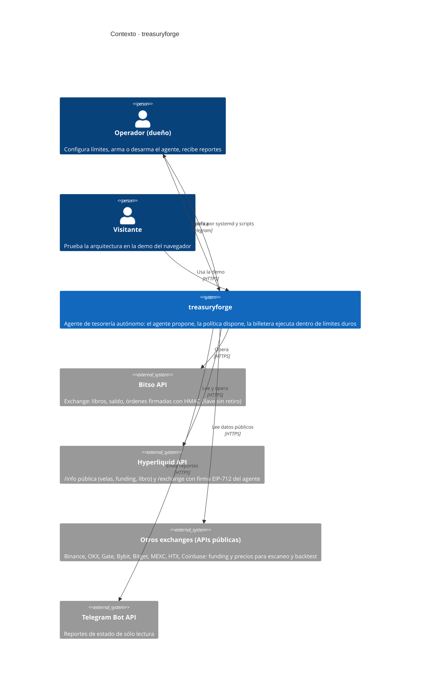
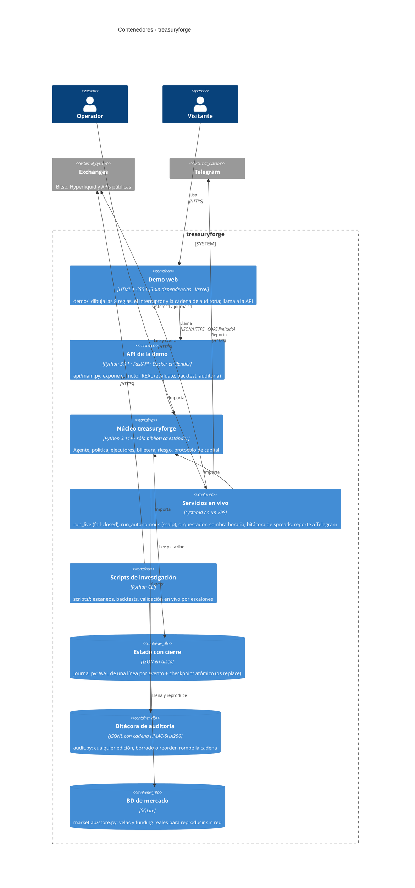
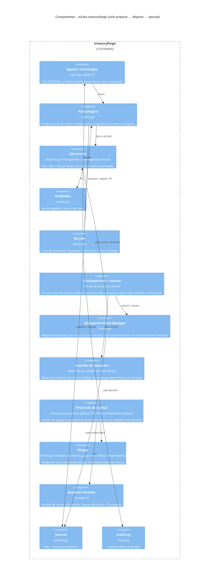
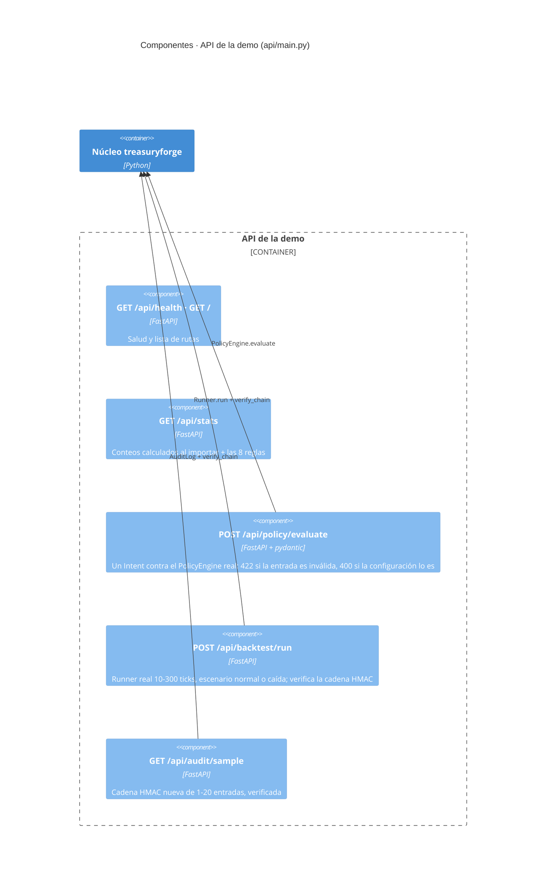

# Arquitectura · treasuryforge

Modelo C4: contexto → contenedores → componentes. Los diagramas son texto (Mermaid), se versionan con el código
y nombran módulos que existen (`treasuryforge/…`, `api/main.py`, `deploy/…`). Las decisiones están en
[`docs/adr/`](../adr/) y las reglas con sus pruebas en [`docs/reglas.md`](../reglas.md).

## 1. Contexto

## 2. Contenedores

## 3. Componentes del núcleo

## 4. Componentes de la API de la demo

## 5. Despliegue

Demo en Vercel, API en Render (Docker) y servicios en vivo en un VPS con systemd: el detalle, la reversa y el
diagnóstico están en [`RUNBOOK.md`](../../RUNBOOK.md).
